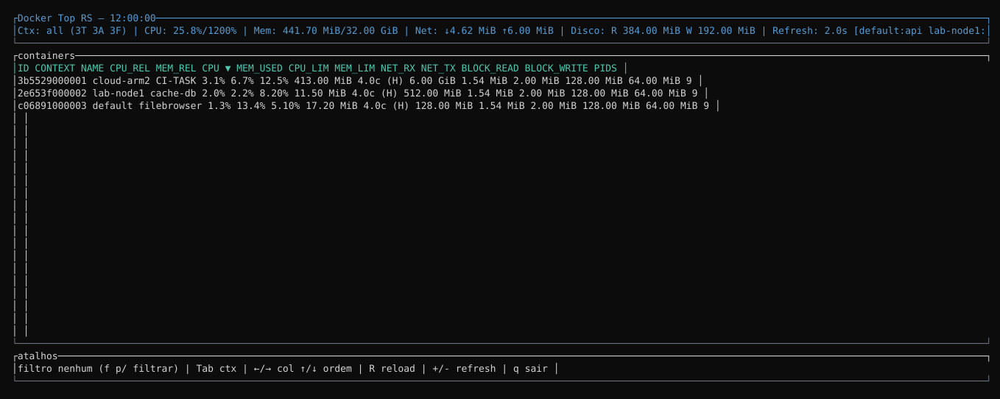

# docker-top-rs

Interactive multi-context Docker container resource monitor — a Rust TUI (ratatui + crossterm) rewrite of my earlier Python `docker-top` tool.




## Why

`docker stats` shows one Docker host at a time. If you run containers across several machines — a local daemon, remote SSH hosts, cloud VMs — you end up with several terminal windows and no consolidated view. `docker-top-rs` discovers every Docker context (and optionally SSH hosts running a Docker daemon), merges them into a single TUI, and lets you sort, filter and drill down across all of them.

It is a faithful port of a ~1250-line Python TUI: same parsers, same 16 sort columns, same 3 responsive layouts, same relative CPU/Mem limit math, `docker inspect` caching, `Tab` to switch contexts, and `--once` for non-interactive use.

## Features

- **Multi-context by transport**: reads `~/.docker/contexts/meta/*/meta.json` + `docker context ls` once at startup.
  `unix://` contexts talk to the Docker API via [bollard](https://crates.io/crates/bollard) (rustls, no openssl); `ssh://` contexts shell out to `docker --context … stats/inspect`.
  Transport is fixed at startup (no per-request flapping), the TUI shows an `api/cli` badge, and each context logs one line to stderr.
- **Dynamic TOML config** at `~/.config/docker-top/config.toml`
  (precedence: defaults < file < `DOCKER_TOP_*` env < CLI flags; built with [figment](https://crates.io/crates/figment) + serde `deny_unknown_fields`).
  Everything is configurable: `refresh_delay`, default sort, timeouts (`context_ls` 3s, `info` 3s, `stats` 30s — SSH hosts with dozens of containers can take ~8s for `stats` alone, `inspect` 30s), warn/crit thresholds, layout widths, formats, keybindings, columns.
  Hot reload with the `R` key or `SIGHUP`. A commented `config.example.toml` is versioned (or run `--generate-config-example`).
- **`DockerProvider` trait** (`Bollard` / `Cli` / `Mock`) for testability.
  Limits cache keyed by `(context, id)` with eviction when the id disappears; `SystemInfo` cached per context.
- **Parsers without heavy regex**, covered by `proptest` and unit tests.
- **ratatui + crossterm rendering**: collection tick decoupled from render (event-driven, no fixed 10 fps), 3 responsive layouts, 16 sort columns, name filter, `Tab` context switch, `--once` mode.

## Install

From source (Rust 1.75+):

```bash
cargo install --git https://github.com/lgldsilva/docker-top-rs
```

Prebuilt binaries for Linux (x86_64), macOS (x86_64/aarch64) and Windows are attached to every [release](https://github.com/lgldsilva/docker-top-rs/releases).

## Usage

```bash
docker-top-rs                  # TUI (all contexts)
docker-top-rs --once           # one shot, TSV to stdout (errors at the end)
docker-top-rs -c lab-node1 -s cpu_rel
docker-top-rs --log /tmp/dt.log          # per-context/tick log (durations, errors)
docker-top-rs --ssh-direct               # ssh:// via plain `ssh <host> docker ...`
docker-top-rs --ssh-hosts                # + hosts from ~/.ssh/config running a docker daemon
docker-top-rs --generate-config-example
```

Keybindings (all remappable in `[keybindings]`):

| Key | Action | Key | Action |
|---|---|---|---|
| `x` | sort CPU % (relative) | `m` | sort MEM % (relative) |
| `c`/`u`/`l`/`k` | CPU/MEM absolute and limits | `1`/`2`/`r` | net rx/tx/total |
| `3`/`4`/`d` | block read/write/total | `p` | pids |
| `n`/`i` | sort by name / id | `s` | toggle order |
| `Tab`/`o` | switch context | `←`/`→`/`↑`/`↓` | column / order |
| `f` | filter | `R` | reload config |
| `+`/`-` | refresh faster/slower | `q` | quit |

## Troubleshooting SSH contexts

- **Context missing / no containers**: the header badge shows `name:cli!` and the red footer line shows the last tick's error (`⚠ ctx: msg`). With `--once` errors appear in the `errors:` section. No error and still empty? Use `--log` and check per-tick durations.
- **First tick is slow**: every SSH host pays a handshake + `stats --no-stream` (hosts with ~60 containers: ~8s). Collection and enrichment run in parallel per context; `info` is cached for 60s per context.
- **`stats` timing out**: raise `[timeouts] stats` in the config (default 30s) or set `DOCKER_TOP_TIMEOUTS__STATS=30`.
- **Faster SSH**: `ControlMaster auto` + `ControlPersist` in `~/.ssh/config` reuses connections between ticks (the tool spawns per tick).
- **`--ssh-direct`**: runs `ssh -o BatchMode=yes -o ConnectTimeout=5 -o StrictHostKeyChecking=accept-new <host> docker stats …` bypassing the docker context machinery (the local `--context` does not cross ssh). Useful when contexts fail or to control ssh options.
- **`--ssh-hosts`**: reads aliases from `~/.ssh/config` (no globs), probes `ssh <host> docker version` in parallel and adds hosts with a daemon as extra contexts — even without a docker context defined. Those contexts only work via direct SSH (marked automatically).

## Configuration

```bash
cp config.example.toml ~/.config/docker-top/config.toml
DOCKER_TOP_REFRESH_DELAY=1.5 docker-top-rs
DOCKER_TOP_TIMEOUTS__STATS=10 docker-top-rs
```

## Security notes

The tool only reads from the Docker API/CLI (`stats`, `inspect`, `info`, `context ls`) and never sends data anywhere. SSH probing (`--ssh-direct`, `--ssh-hosts`) uses `BatchMode` so it never prompts for passwords. Config may contain host names/aliases you may not want to share — think before committing `config.toml` anywhere public (an example file with dummy hosts is committed here).

## License

[MIT](LICENSE)
